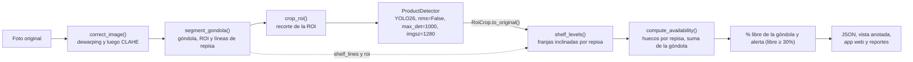
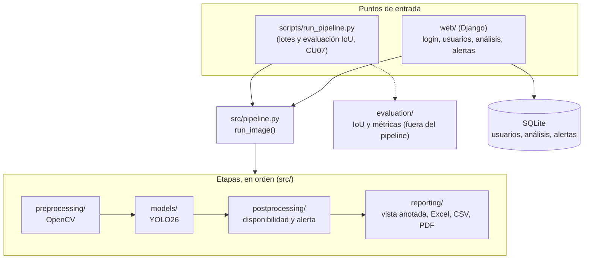

# Auditoría Automatizada de Góndolas mediante Visión Artificial (Walmart Chile)

## 📌 Descripción General del Proyecto

Este repositorio contiene el código fuente, la documentación técnica y la arquitectura del sistema desarrollado para la asignatura **Proyecto de Título (APT122 / Capstone)** en **Duoc UC**, en colaboración con **Walmart Chile**.

El proyecto aborda la automatización de la auditoría de espacios en salas de venta de supermercados mediante algoritmos de **Visión Artificial (Computer Vision)**. La solución analiza capturas fotográficas de cámaras de seguridad para detectar en tiempo real la disponibilidad de stock y cuantificar los espacios vacíos en góndola ("quiebres de stock" e "inventarios fantasmas").

### La solución en breve

**Entrada**: una foto de góndola (frontal, en ángulo o desde arriba; se admite lente gran angular). **Salida**, por foto y para la **góndola completa**: el % de espacio libre, la alerta de quiebre (sí/no, libre ≥ 30%) y la foto anotada con los huecos en rojo. Todo sale en un JSON, en la vista anotada y en la aplicación web. El sistema no identifica productos ni SKU: solo decide si hay producto o hueco en cada lugar del frente.

Cómo lo hace, en cuatro pasos (detalle en "Estrategia Algorítmica y Arquitectura"): (1) **OpenCV** corrige la imagen y segmenta la góndola y sus repisas; (2) **YOLO26** detecta los productos dentro de esa ROI; (3) se calcula qué parte del frente queda sin producto; (4) se informa el resultado. En la CPU de un PC de escritorio tarda ~0,5 s por foto en un lote (mediana) y ~2 s una foto suelta, por el arranque del modelo (objetivo RF01: 2 a 5 s).

Estado de las métricas (detalle y fotos en [docs/analisis-resultados.md](docs/analisis-resultados.md)): el detector llega a mAP50 0,950 en el *test* de SKU-110K y a 0,713 en 45 fotos de Kaggle que no vio al entrenar; el sistema completo acierta la alerta en 92% de las fotos de productos envasados (33/36). Los puntos débiles conocidos (frutas a granel, vidrio y reflejos) están en "Estado operativo y pendiente".

---

## 🎯 Definición del Alcance

### 1. Dominio de Aplicación
* **Categoría Seleccionada**: Góndolas de **Alimentos No Perecibles** (cajas, latas, frascos, bolsas).
* **Actualización de Alcance**: Se descarta de forma definitiva el monitoreo de cestas de panadería, enfocando la arquitectura exclusivamente en la complejidad visual de los estantes de no perecibles.
* **Desafíos Visuales del Entorno**:
  * **Alto ruido visual**: Variaciones abruptas de iluminación, reflejos en empaques plásticos/metálicos y sombras al fondo del estante.
  * **Perspectiva y lentes**: Distorsión óptica por ángulos oblicuos de cámaras de seguridad y lentes tipo *fisheye*.
  * **La Trampa del Apilamiento**: Diferenciación entre espacio libre útil para reposición y espacio vertical vacío donde no es posible apilar productos por fragilidad o geometría.

### 2. Supuestos del Dominio
* **Segmentación automática de ROI**: El sistema detecta por sí solo la góndola y sus repisas en cada imagen. Ningún usuario dibuja ni configura zonas ROI por cámara.
* **Profundidad constante de góndola**: Las góndolas reales tienen entre 20 y 30 cm de profundidad; el sistema usa un valor fijo de **25 cm** para todos los casos. No estima profundidad: analiza la vista frontal 2D de la góndola, y en el Nivel 1 el volumen libre se obtiene del área frontal libre multiplicada por esos 25 cm. Walmart confirmó que el análisis 2D basta y que la profundidad no es necesaria. También indicó que las góndolas tienen medidas estándar y quedó de enviarlas: si la profundidad estándar no es 25 cm, se cambia esta constante (sigue siendo una sola, global).
* **Fachada visible**: se mide solo lo que la cámara ve de frente. Si el frente de una repisa está lleno, se supone que detrás también hay producto: es lo que ve el cliente, y la cámara no da información del fondo.
* **Sin apilamiento**: no se mide la altura de los productos. Ningún producto se considera apilable, así que el espacio vertical sobre un producto no cuenta como hueco. Es la respuesta del sistema a "La Trampa del Apilamiento".
* **Una sola clase de producto**: basta saber si hay producto o no; no se identifica el SKU ni la categoría.
* **Quiebre por góndola completa** (cambio de alcance del 2026-10-19, indicado por el profesor): el quiebre de stock se determina sobre la góndola completa, no por nivel o repisa. El sistema entrega una sola alerta y un solo porcentaje de espacio libre por góndola. Internamente sigue midiendo repisa por repisa, porque así la medición funciona con la cámara en ángulo (las repisas se ven inclinadas, ítem #22), pero no informa alertas ni porcentajes por repisa. Código, casos de uso y diagramas adaptados en el ítem #40.
* **Qué se mide**: la góndola de venta que ve el cliente. Quedan fuera la bodega de reserva sobre la góndola y las islas centrales del pasillo (excluir la bodega superior está pendiente, #31).

### 3. Acuerdos con el Cliente (Walmart)

Resumen de lo acordado en las reuniones con Walmart Chile (las minutas no se versionan). Las preguntas por confirmar van en el ítem #24 de [PROGRESS.md](PROGRESS.md).

| Tema | Acuerdo | Reunión | Estado |
| :--- | :--- | :--- | :--- |
| Problema | Detectar espacios vacíos (quiebres de stock) en góndolas; la pregunta central es si hay quiebre o no | 2026-09-03, 2026-09-30 | Vigente |
| Alcance | La primera reunión propuso partir, en principio, con góndolas de pan y pollo. El equipo eligió no perecibles porque son los que tienen datasets públicos anotados, y después Walmart recomendó partir por la categoría con más datos | 2026-09-03, 2026-09-16 | Por confirmar (#24) |
| Métrica | Porcentaje de espacio libre de la góndola completa (Nivel 1); como mínimo, alerta por umbral del 30% (Nivel 2). El acta pedía además detalle por repisa: lo reemplaza el cambio del 2026-10-19 | 2026-09-03, 2026-10-19 (profesor) | Vigente |
| Sentido del umbral | El acta lo plantea como "menos del 30% de productos disponibles"; el sistema alerta con **espacio libre >= 30%** del frente (decidido 2026-09-30, #6). El umbral es configurable (CU05, página "Configuración" de la app web) y los reportes informan el % libre, así que sirven para cualquiera de las dos lecturas | 2026-09-03 | Por confirmar (#24) |
| Nivel de la alerta | **Góndola completa**, no por nivel o repisa (cambio de alcance indicado por el profesor; antes lo elegía el equipo y se mostraba también el detalle por repisa). Implementación: #40 | 2026-09-30, 2026-10-19 (profesor) | Vigente |
| Criterios | Todo criterio del equipo (fachada visible, sin apilamiento, hueco de al menos un ancho de producto) es válido si se justifica ante el negocio | 2026-09-16 | Vigente |
| Imágenes | Las fotos de Walmart son de muchos tipos (frontales, en ángulo, desde arriba) y no vienen recortadas a la góndola. Walmart no comparte fotogramas de sus cámaras (ver "Estrategia de Datos y Evaluación") | 2026-09-16, 2026-10-01 | Vigente |
| Fotos propias | El equipo debe tomar fotos reales de góndolas; sirven para entrenar si se clasifican por ángulo (#32) | 2026-09-03, 2026-09-16 | Pendiente |
| Evaluación de Walmart | Mide IoU contra una anotación hecha a mano y evalúa el criterio de la solución; no exige un resultado perfecto. La nota la ponen los docentes | 2026-09-16 | Vigente |
| Interfaz | Es opcional y debe justificarse: lo primero es que la lógica funcione | 2026-09-16 | Vigente |
| Modelo | Libre; se prefiere uno que el equipo pueda explicar a uno con más rendimiento | 2026-09-03, 2026-09-30 | Vigente |
| Repositorio | En GitHub, público y actualizado de forma continua | 2026-09-03 | Vigente |

---

## 💡 Objetivos y Niveles de Solución

El proyecto contempla una estructura de dos niveles de solución para garantizar la viabilidad técnica:

| Criterio | Solución Óptima (Nivel 1) | MVP Alternativo (Nivel 2) |
| :--- | :--- | :--- |
| **Objetivo Principal** | Medición espacial y volumétrica exacta del espacio libre (profundidad constante de 25 cm) | Alerta macro por umbral binario de stock |
| **Métrica de Salida** | Porcentaje exacto (o cm, con escala) de espacio vacío de la góndola completa | ¿Espacio libre ≥ 30% del frente de la góndola? (Sí / No) |
| **Granularidad** | Góndola completa (desde 2026-10-19). Las repisas, detectadas automáticamente, son solo el método interno de medición | Góndola completa, detectada automáticamente |
| **Complejidad** | Alta (Segmentación espacial + Visión Computacional) | Media (Detección por umbral de píxeles / parches) |

---

## 🛠️ Requerimientos Funcionales (RF)

* **RF01 - Ingesta de Imágenes**: Procesamiento estático de fotogramas en formato imagen, de una cámara de sala o de un lote de fotos (frontales, en ángulo o desde arriba). Tiempo de inferencia objetivo: 2 a 5 segundos por imagen.
* **RF02 - Detección de Espacios Vacíos**: Identificación de regiones sin producto dentro de las regiones de interés (ROI) correspondientes a la góndola, que el sistema segmenta automáticamente.
* **RF03 - Cálculo de Disponibilidad**: Estimación cuantitativa del espacio libre (porcentaje/cm o alerta cuando el espacio libre llega al 30% del frente de la góndola), asumiendo profundidad de góndola constante (25 cm).
* **RF04 - Generación de Alertas**: Emisión de notificaciones prioritarias para el equipo de reposición cuando se detecte un quiebre de stock (una alerta por góndola completa, sin alertas por repisa). Opcional: alerta de cámara defectuosa cuando la imagen tiene colores imposibles.
* **RF05 - Módulo de Reportería**: Exportación de datos analíticos auditados en formatos **Excel (.xlsx)**, **CSV** y **PDF**. Contenido mínimo: % libre de la góndola completa y alerta sí/no. Walmart no pide un formato: los tres son decisión del equipo.
* **RF06 - Evaluación por Lotes**: Ejecutar el sistema sobre un lote de imágenes anotadas a mano y entregar métricas (IoU de detección y acierto de la alerta) sin que las imágenes salgan de la máquina donde corre. Es la forma en que Walmart puede evaluar con su Dataset Oculto.

---

## 👥 Perfiles de Usuario

La interfaz va después del pipeline: Walmart pidió priorizar que la lógica funcione. La aplicación web (ver "Aplicación web") ya tiene el login por perfil (CU00), la gestión de usuarios y roles (CU06), el análisis de fotos (CU01), las alertas (CU02), el dashboard de góndolas (CU03), los reportes (CU04) y la configuración de umbral y cámaras (CU05). Los casos de uso CU00-CU07 están en `Anexos/Diseño/`.

1. **Reponedor de Tienda**: Recibe alertas inmediatas en dispositivos móviles para acudir a los pasillos con quiebre crítico.
2. **Jefe de Salón / Supervisor**: Visualiza dashboards de disponibilidad por pasillo y exporta reportes periódicos de desempeño.
3. **Administrador de Sistema**: Configura planogramas, cámaras y umbrales de alerta, y gestiona usuarios. No define zonas ROI: el sistema segmenta la góndola automáticamente.

---

## 🏗️ Estrategia Algorítmica y Arquitectura

* **Enfoque Híbrido**: Evaluación de modelos de extracción de características (**YOLO26** de Ultralytics, con cabeza sin NMS para góndolas densas) combinados obligatoriamente con **Visión Computacional Clásica** (detección de bordes, transformaciones matriciales y filtros morfológicos) para mantener control matemático sobre el ruido visual. La segmentación automática de la góndola y sus repisas es parte de este pre-procesamiento clásico: se ejecuta sobre la imagen ya corregida (dewarping de lente y luego CLAHE) y antes de la inferencia. Después de la inferencia, los niveles de repisa que se miden combinan las repisas de la segmentación con las filas de productos detectados, como franjas inclinadas: así el cálculo sigue funcionando con la cámara en ángulo (vista oblicua o cámara de sala), donde las repisas se ven inclinadas.
* **Pipeline Modular**: Separación física de los componentes de *Pre-procesamiento*, *Inferencia de Modelo* y *Post-procesamiento*.
* **Código de Producción**: Desarrollo exclusivo en scripts modulares de Python (`.py`), descartando notebooks para la ejecución core.
* **Aplicación web con Django** (decidido 2026-10-18, ítem #28): el diagrama de la Fase 1 proponía una API FastAPI/Flask con JWT y un frontend React. Se eligió Django con SQLite y páginas generadas en el servidor porque trae ya probados el login, los roles (grupos), el hash de contraseñas (bcrypt, como pedía el diseño), la protección CSRF, el ORM y las migraciones: el equipo no escribe a mano código de seguridad. Un frontend aparte (React) duplicaba el trabajo y sumaba Node al CI y a Docker para una interfaz que Walmart considera opcional. Se mantienen los módulos del diseño: backend Python, RBAC, base de datos relacional y vistas por perfil. En vez de JWT se usa la sesión de Django (cookie firmada, `HttpOnly`): CU06 pide invalidar al instante las sesiones de un usuario desactivado, y un JWT no se puede revocar antes de que expire. La app solo llama a `run_image()` de `src/pipeline.py`, como `scripts/run_pipeline.py`: no toca las etapas.

### Flujo de una foto



Las cajas viajan siempre como `[x_min, y_min, x_max, y_max]` en píxeles. Después de detectar, vuelven a la imagen corregida con `RoiCrop.to_original()` y a la foto original con `CorrectedImage.to_original()`, así que la vista anotada y el JSON usan las coordenadas de la foto que subió el usuario.

### Componentes



Cada etapa vive en su paquete y no importa los detalles de otra: se pasan arrays, tuplas y *dataclasses*. `src/pipeline.py` es el único que las encadena, y tanto el CLI como la app web solo llaman a `run_image()`. Los diagramas de diseño de la Fase 1 (casos de uso y arquitectura) están en `Anexos/Diseño/`, actualizados a la app Django el 2026-10-21 (ítem #42); sus fuentes Mermaid, en `Anexos/Diseño/Diagramas fuente (Mermaid)/`.

La especificación técnica (qué recibe y entrega cada etapa, parámetros con sus valores, formato del JSON de salida, rutas y permisos de la app web y modelo de datos) está en [docs/especificacion-tecnica.md](docs/especificacion-tecnica.md).

### Decisiones técnicas y su justificación

| Decisión | Por qué | Evidencia |
| :--- | :--- | :--- |
| **OpenCV antes de YOLO26** (corrección, segmentación y recorte, en ese orden) | El ruido de una cámara de sala (lente, sombras, perspectiva) se controla mejor con operaciones que el equipo puede explicar y ajustar; Walmart prefiere un modelo explicable. Recortar a la góndola evita que el pasillo, el techo y los carteles cuenten como huecos. Dewarping antes de CLAHE porque la ecualización no debe trabajar sobre una imagen curva | Acotar la góndola a lo detectado, en vez de usar toda la ROI, bajó las falsas alertas con la góndola llena de 24,7% a 4,0% (ítem #6); F1 de repisas en SHARD de 0,82 (ítem #15) |
| **YOLO26 con cabeza sin NMS** (`nms=False`, `max_det=1000`, `imgsz=1280`) | En góndolas densas y apiladas, el NMS suprime productos vecinos que se tocan, y el límite por defecto de 300 cajas trunca góndolas llenas. Entrenar y validar con los mismos valores hace que `best.pt` salga del mismo modelo que se usa al inferir | 690 latas detectadas como 714 en una foto densa (foto 002 de Kaggle); la variante `yolo26s-p2` (cabeza para objetos chicos) no mejoró (mAP50-95 0,596 contra 0,606) y costó el doble, así que se eligió `yolo26s` |
| **Niveles de repisa híbridos** (`shelf_levels()`: filas de productos + líneas de la segmentación) | Con la cámara en ángulo las repisas se ven inclinadas y los rectángulos horizontales de la segmentación se meten en las repisas vecinas: los productos de una tapan los huecos de otra. Las bases de los productos marcan la repisa aunque esté inclinada, y las líneas de la segmentación aportan las repisas vacías | Foto real en ángulo (Kaggle 039): 3 franjas siguiendo las repisas y 5% libre, contra 5 niveles cruzados y huecos falsos de 77% y 36% solo con la segmentación (ítem #22) |
| **Profundidad constante de 25 cm** | Walmart confirmó que el análisis 2D de la vista frontal basta; las góndolas miden entre 20 y 30 cm. Estimar profundidad (modelos de profundidad o estéreo) agregaría un error que no se puede verificar sin fotos de Walmart | Una sola constante global; si Walmart envía las medidas estándar, se cambia ese valor |
| **Umbral: alerta con espacio libre ≥ 30% del frente** | El acta lo plantea como "menos del 30% de productos disponibles"; leído al pie de la letra alertaba con la góndola llena, así que se invirtió a espacio libre. Lo configura el Administrador en la app web (CU05, entre 1% y 100%; `run_image(critical_free_fraction=...)`) | Con recall simulado de 0,9, umbrales de 20/25/30/35% dan 20,7/8,7/4,0/1,0% de falsas alertas con la góndola llena, y un quiebre de 30% se detecta en 87% de los casos (ítem #6) |
| **Una alerta por góndola completa, repisas solo para medir** | Cambio de alcance indicado por el profesor el 2026-10-19. Las repisas siguen siendo el método interno, porque medir la cobertura a lo largo de cada repisa funciona con la cámara en ángulo; pero no se informa alerta ni % por repisa | Ítem #40; JSON con `free_fraction` y `critical` de la góndola y `shelves` solo con geometría |
| **Fachada visible, sin apilamiento, hueco de al menos un ancho de producto** | Es lo que ve el cliente; la altura es el eje que más deforma una cámara de sala. Un hueco más angosto que un producto no se puede reponer | Criterio del equipo, válido ante Walmart si se justifica (reunión 2026-09-16) |
| **Reportes en Excel, CSV y PDF**, una fila por análisis | Walmart no pide un formato (RF05), así que se eligió uno por uso: Excel para que el Jefe de Salón filtre y grafique (el % libre va como número), CSV para cargarlo en otros sistemas (UTF-8 con BOM, para que Excel muestre bien las tildes) y PDF para imprimir o archivar una auditoría sin que se edite. Cada fila trae fecha, pasillo, góndola, % libre de la góndola completa y alerta sí/no (el contenido mínimo), más el estado de la alerta y quién subió la foto; nada por repisa (#40). Sin análisis en el período no se genera un archivo vacío (CU04) | `tests/test_report_export.py` y las pruebas de CU04 en `tests/test_web.py` (ítem #7) |
| **Django con sesiones en vez de FastAPI + React + JWT** | Trae login, roles, hash de contraseñas, CSRF y migraciones probados; Walmart considera la interfaz opcional | Ver "Aplicación web con Django", arriba, y el ítem #28 |

---

## 📊 Estrategia de Datos y Evaluación

* **Dataset de Entrenamiento**: Curaduría propia mediante fuentes públicas open-source (ej. *SKU-110K*, *Hugging Face Grocery Shelves*, *Kaggle Supermarket Shelves*) con estandarización estricta de coordenadas de anotación (`[x_min, y_min, x_max, y_max]`).
* **Sin imágenes reales de Walmart**: por privacidad, Walmart Chile no puede compartir imágenes de sus cámaras de seguridad (informado el 2026-10-01). Las condiciones de cámara de sala (vista alta y oblicua, lente gran angular/*fisheye*, baja resolución, compresión) se simulan generando imágenes sintéticas desde los datasets públicos, transformando también sus anotaciones (ver [docs/datasets.md](docs/datasets.md)).
* **Prueba Ciega (Dataset Oculto)**: la evaluación contra el **Dataset Oculto** de Walmart Chile (imágenes reales de sala con condiciones complejas) solo es posible si Walmart ejecuta el sistema en sus instalaciones (imagen Docker) y entrega las métricas, sin que las imágenes salgan de la empresa (RF06, CU07). Modalidad por confirmar con Walmart. Sus imágenes no son solo de cámaras de sala: hay fotos frontales, en ángulo y desde arriba.
* **Cómo evalúa Walmart**: IoU contra una anotación hecha a mano, más una evaluación cualitativa del criterio de la solución. Para medirnos igual, el plan de pruebas debe incluir un set propio anotado a mano (#32).
* **Fotos propias**: el equipo debe tomar fotos reales de góndolas (con permiso de la tienda), clasificadas por ángulo (frontal, lateral, desde arriba, gran angular). Sirven para entrenar, como control de vistas en ángulo y como material de demo que no es SKU-110K (#32).

### Datasets: origen, cantidad, limpieza, etiquetado y preparación

| Dataset | Origen y licencia | Imágenes y anotaciones | Para qué se usa |
| :--- | :--- | :--- | :--- |
| SKU-110K | Trax Retail (CVPR'19); académico, no comercial, sin redistribuir ni modificar | 11.743 fotos (train 8.219, val 588, test 2.936) y 1.730.996 cajas de producto | **Único dataset de entrenamiento** de `yolo26s`; evaluación en val y test. Nunca en demos ni en vistas sintéticas |
| Kaggle supermarket-shelves | Humans in the Loop; CC0 | 45 fotos, 9.967 cajas de producto (y 1.776 de precio, que no se usan) | Evaluación fuera de SKU-110K (#34), demos y vistas en ángulo sintéticas |
| Roboflow Out Of Stock detection | Roboflow Universe; CC BY 4.0 | 3.024 fotos, 15.720 cajas de espacio vacío | Medir quiebres reales (pendiente, #33) |
| Roboflow Empty Shelf Detector | Roboflow Universe; CC BY 4.0 | 317 fotos (train 284, valid 17, test 16), 2.080 cajas de espacio vacío | Igual que el anterior |
| UniDataPro grocery-shelves | Hugging Face; CC BY-NC-ND 4.0 | 15 fotos de muestra, 94 cajas | Pruebas de los conversores |
| SHARD | figshare; CC BY 4.0 | 22.743 fotos con la altura de cada repisa | Medir `segment_gondola()` (F1 0,82); no tiene cajas de producto |

* **Limpieza**: los 712 JPEG truncados de SKU-110K se copian en vez de enlazarse, porque Ultralytics los repara reescribiéndolos y habría modificado el original; las cajas sin área se descartan al convertir; en SHARD se usa el `annotation.csv` completo de figshare (el del `.7z` viene truncado y trae 2 fotos repetidas); en Kaggle la foto 035 es la misma que la 004 y se cuenta una vez. Los precios de Kaggle se separan de los productos (`class_group`).
* **Etiquetado**: el equipo no etiquetó fotos a mano; todas las anotaciones vienen de los datasets. Cada formato (CSV, COCO, XML, Supervisely) se convierte con `scripts/prepare_datasets.py` a `[x_min, y_min, x_max, y_max]` en píxeles absolutos. Para el detector hay una sola clase, `product`. Las fotos propias con anotación a mano son el ítem #32.
* **Preparación**: se conservan los *splits* oficiales de SKU-110K; Kaggle y UniDataPro no se parten porque no se usan para entrenar. `scripts/prepare_yolo_dataset.py` arma el formato de Ultralytics enlazando las imágenes. Todo se descarga con `scripts/download_datasets.py` (versiones fijas, ver [docs/datasets.md](docs/datasets.md)) y nada se versiona.

---

## 🚦 Estado Operativo y Pendiente

Al 2026-10-20. El detalle por ítem y su dueño están en [PROGRESS.md](PROGRESS.md).

| Módulo o requisito | Estado |
| :--- | :--- |
| Corrección de imagen (dewarping y CLAHE) | Operativo. El dewarping necesita calibración de lente: sin ella solo se aplica CLAHE |
| Segmentación automática de góndola y repisas | Operativo. F1 de repisas 0,82 en SHARD; limitaciones conocidas en el ítem #17 |
| Detector YOLO26 (`yolo26s`) | Operativo. mAP50-95 0,610 en el *test* de SKU-110K; 0,423 en las 45 fotos de Kaggle |
| Disponibilidad y alerta por góndola completa (RF02, RF03, RF04) | Operativo |
| Ingesta y evaluación por lotes (RF01, RF06, CU07) | Operativo (`scripts/run_pipeline.py`); ~0,5 s por foto en lote, en CPU |
| Aplicación web: login (CU00), usuarios y roles (CU06), análisis (CU01) y alertas (CU02) | Operativo |
| Reportes Excel, CSV y PDF (RF05, CU04, #7) | Operativo: página "Reportes" de la app web (`src/reporting/export.py`) |
| Configuración de umbral y cámaras (CU05, #44) | Operativo: página "Configuración" de la app web |
| Dashboard de disponibilidad (CU03, #43) | Operativo: página "Góndolas" de la app web |
| Instalación en el servidor del CITT (#39) | Bloqueado: esperan las instrucciones |

**Limitaciones conocidas** (análisis completo en [docs/analisis-resultados.md](docs/analisis-resultados.md)):

* El detector pierde productos fuera de su dominio (recall 0,644 en Kaggle contra 0,885 en SKU-110K), y cada producto perdido cuenta como hueco: produce falsas alertas (6 de 44 fotos). Siguiente paso: *fine-tuning* con fotos fuera de SKU-110K (#33, #32).
* Las frutas y verduras a granel quedan fuera del alcance (no perecibles): recall 0,16.
* Refrigeradores con puerta de vidrio: reflejos, desenfoque y marcos dan falsas alertas (#46).
* La bodega de reserva sobre la góndola todavía se mide como parte de ella (#31).
* El set de prueba tiene solo un quiebre real: mide falsas alertas, no cuántos quiebres detecta. Hacen falta las fotos de Roboflow Out Of Stock y las propias (#33, #32).
* No hay imágenes de cámaras de sala reales: las vistas en ángulo son sintéticas, y la evaluación con el Dataset Oculto depende de que Walmart la ejecute en sus instalaciones.

---

## 📁 Estructura del Repositorio

```text
.
├── docs/                   # Especificación técnica (especificacion-tecnica.md), pruebas, datasets, entrenamiento y requisitos del curso (curso.md)
├── src/                    # Código fuente en scripts Python modulares
│   ├── preprocessing/      # Filtros de imagen, segmentación automática y recorte de ROI
│   ├── models/             # Módulos de inferencia (YOLO26 / CV Clásico)
│   ├── postprocessing/     # Cálculo de disponibilidad y alerta (libre ≥ 30%)
│   ├── reporting/          # Generadores de reportes (Excel, CSV, PDF)
│   └── evaluation/         # Métricas de evaluación (fuera del pipeline)
├── scripts/                # CLI del pipeline y visor de segmentación
├── web/                    # Aplicación web Django (login, usuarios y roles, análisis de fotos)
├── manage.py               # Comandos de Django (runserver, migrate, createsuperuser)
├── data/                   # Datasets (data/raw y data/processed, no versionados)
├── tests/                  # Pruebas unitarias e integración (pytest)
├── Fase 1/                 # Entregables académicos de la Fase 1 (no modificar)
├── Dockerfile              # Imagen de la app web y del pipeline (python:3.13-slim-trixie)
├── CLAUDE.md               # Memoria de proyecto y reglas de código para IA
├── PROGRESS.md             # Bitácora de tareas por sprint
├── README.md               # Documentación principal del repositorio
└── requirements.txt        # Dependencias del proyecto
```

### Configuración de un entorno nuevo

Requisitos: git, Python 3.12 o superior (Django 6.1 lo exige; el CI y la
imagen Docker usan 3.13, y también se usa 3.14 en local) y acceso de escritura al repositorio
(invitación de GitHub aceptada).

**1. graphify, una vez por PC y fuera del venv.** Los hooks de Claude Code
(`.claude/settings.json`) llaman a `graphify` en cada búsqueda o lectura
sin activar el venv, así que tiene que estar en el `PATH` del sistema.
Se instala con [uv](https://docs.astral.sh/uv/), sin el venv activado:

```bash
winget install astral-sh.uv        # o: python -m pip install uv
uv tool install graphifyy==0.9.70
uv tool update-shell               # agrega ~/.local/bin al PATH; cerrar y reabrir la terminal y VS Code
graphify --version                 # debe decir 0.9.70
```

**2. Proyecto:**

```bash
git clone https://github.com/marianapeachy/capstone.git && cd capstone
python -m venv .venv            # activar: .venv\Scripts\activate (Windows) / source .venv/bin/activate
pip install -r requirements.txt
graphify update .               # genera graphify-out/ (no se versiona)
cp .env.example .env            # opcional: API key de Roboflow (Windows: copy .env.example .env)
pytest tests/
```

`pytest tests/` no necesita datasets, pesos ni GPU: construye YOLO26 desde
su YAML, sin conexión. Si todo pasa, el entorno quedó listo.

**3. Claude Code:** crear `CLAUDE.local.md` en la raíz (no se versiona)
con la línea `Integrante: <nombre>` (el mismo nombre que se usa en
`(dueño: <nombre>)` de `PROGRESS.md`). Con eso Claude sabe qué ítems son
de cada uno y cuál proponer después (ver "Trabajo en equipo" en
`CLAUDE.md`).

- **PowerShell no deja activar el venv** ("la ejecución de scripts está
  deshabilitada"): correr una vez
  `Set-ExecutionPolicy -Scope CurrentUser RemoteSigned` y volver a
  activar.
- **`graphify --version` no da 0.9.70**: otra copia de `graphify` tapa
  la de `uv tool` en el `PATH` (p. ej. una instalada con `pip` en el
  Python global o en un venv). `where.exe graphify` (Windows) o
  `which -a graphify` (bash) lista todas en orden; la primera debe ser
  la de `%USERPROFILE%\.local\bin`. Quitar las otras con
  `pip uninstall graphifyy` en el Python donde estén.
- **Datos** (no se versionan): `python scripts/download_datasets.py` los
  descarga a `data/raw/` (Roboflow pide `ROBOFLOW_API_KEY`; ver
  [docs/datasets.md](docs/datasets.md)) y luego `python scripts/prepare_datasets.py`.
  `python scripts/evaluate_shard.py` mide la segmentación de repisas contra
  SHARD (`--dataset shard`, 3.6 GB). SKU-110K (12.2 GB) y SHARD (3.6 GB)
  son descargas grandes y pueden cortarse por timeout o reinicio de
  conexión; el script reanuda desde donde quedó, así que basta con
  volver a correr `python scripts/download_datasets.py` las veces que
  haga falta hasta que termine.
- **Claude Code**: instalar la extensión "Claude Code" de Anthropic en VS Code
  e iniciar sesión con la cuenta propia. Claude lee `CLAUDE.md` al empezar, que
  incluye el flujo de trabajo en equipo (ramas, PR y dueños de ítems). Al abrir
  el proyecto, aceptar la instalación de los plugins compartidos
  (`yolo@ultralytics`, `superpowers` y `ponytail`, declarados en
  `.claude/settings.json`). Ponytail requiere Node.js (corre sus *hooks*
  con `node`); después de instalarlo, desactivar su registro de costos con
  `/plugin configure ponytail@ponytail` (`ledger` en falso). Desde la
  terminal: `claude plugin install ponytail@ponytail --scope project
  --config ledger=false`.
- **GitHub CLI** (`gh auth login`) para abrir Pull Requests desde la terminal.
- **Docker Desktop** para construir y probar la imagen (ver abajo).
- **Entrenamiento del detector** (PC con GPU NVIDIA): ver
  [docs/training.md](docs/training.md). En Windows, `pip install -r
  requirements.txt` instala PyTorch sin CUDA; para usar la GPU hay que
  reinstalarlo como indica esa guía (paso 1). Para el resto del proyecto
  basta el PyTorch sin CUDA.
- **Antes de tomar trabajo**: leer la sección "Trabajo en equipo" de
  `CLAUDE.md` y elegir un ítem sin dueño de [PROGRESS.md](PROGRESS.md).

### Ejecución local

```bash
pip install -r requirements.txt
pytest tests/
python scripts/run_pipeline.py FOTOS_O_CARPETAS... [--device cpu] [--out data/processed/pipeline]
```

`run_pipeline.py` corre el pipeline completo (corrección, segmentación,
YOLO26 y disponibilidad) sobre fotos o carpetas. Por foto escribe la
vista limpia (`<nombre>.jpg`: huecos en rojo, contorno de las repisas
medidas y un cartel con la alerta y el % libre de la góndola completa) y
el resultado completo (`<nombre>.json`), e imprime el % libre, la alerta y
los segundos por etapa. En el JSON, `free_fraction` y `critical` son los
de la góndola completa; `shelves` solo trae la geometría de cada repisa
medida (contorno, huecos y número de productos), sin % ni alerta por
repisa: las repisas son el método para medir, no una salida. Una foto
sin productos detectados (tapada, oscura o sin góndola) no tiene % libre
ni alerta: se anota en la tabla y no se escriben su vista ni su JSON. Usa por defecto los pesos de
`data/processed/training/yolo26s/weights/best.pt` (no se versionan: se
comparten dentro del equipo, ver `docs/training.md`).

Evaluación por lotes (CU07, RF06): con
`--annotations data/processed/annotations/<dataset>.csv` compara las
detecciones con la anotación hecha a mano por IoU (`--iou`, 0.5 por
defecto) y la alerta con la que da la misma anotación, y escribe
`metrics.csv` (una fila por foto anotada y el total). Las imágenes no
salen de la máquina: solo se escriben métricas.

Las etapas también se prueban por separado:
`python scripts/visualize_segmentation.py` (segmentación, requiere
datasets en `data/raw/`) y los scripts `evaluate_*.py`.

#### Reproducir un ejemplo de punta a punta (para quien no es del equipo)

Necesita Python 3.12 o superior y unos 2 GB libres; la CPU basta.

```bash
git clone https://github.com/marianapeachy/capstone.git && cd capstone
python -m venv .venv && source .venv/bin/activate     # Windows: .venv\Scripts\activate
pip install -r requirements.txt
pytest tests/                                          # sin datos, pesos ni GPU; debe pasar completo

# 1. Fotos de ejemplo: 45 fotos de góndolas, CC0 (Kaggle), se pueden mostrar
python scripts/download_datasets.py --dataset kaggle_supermarket

# 2. Pesos del detector (ver abajo) en data/processed/training/yolo26s/weights/best.pt

# 3. Una foto: guarda la vista anotada (026.jpg) y el resultado (026.json) en salida/
python scripts/run_pipeline.py "data/raw/supermarket-shelves/Supermarket shelves/images/026.jpg" \
    --device cpu --out salida
```

Resultado esperado con `yolo26s`: la foto 026 (botellas de vidrio en filas, de frente) da `free_fraction` ≈ 0,02 y `critical: false`, es decir ~2% libre y sin alerta. La 011 (estante con pocos productos) es el único quiebre real del set: se espera ver ahí un % libre alto, cerca del umbral (el sistema da 27% y la anotación, 39%; ver el caso en el análisis). Para medir contra la anotación hecha a mano, agregar `--annotations data/processed/annotations/kaggle_supermarket.csv` (se genera con `python scripts/prepare_datasets.py --dataset kaggle_supermarket`); escribe `metrics.csv` con P, R, IoU y la alerta de cada foto. La tabla completa del equipo está en [docs/analisis-resultados.md](docs/analisis-resultados.md).

**Los pesos (`best.pt`) no están en el repositorio**: salen de SKU-110K, cuya licencia prohíbe redistribuirlo, y el equipo no los publica. Hay dos caminos: pedirlos al equipo (se entregan por un canal privado, solo para uso académico y no comercial) o entrenarlos con [docs/training.md](docs/training.md) (GPU NVIDIA de 8 GB; ~7,5 h para `yolo26s`). Con los pesos de COCO (`yolo26s.pt`) el programa corre, pero no detecta la clase "producto" y el resultado no sirve.

### Aplicación web

```bash
export DJANGO_DEBUG=1               # desarrollo (PowerShell: $env:DJANGO_DEBUG="1"); sin esto exige DJANGO_SECRET_KEY y HTTPS
python manage.py migrate            # crea la base (data/processed/web/db.sqlite3) y los 3 perfiles
python manage.py createsuperuser    # primer Administrador (RUT, correo y contraseña)
python manage.py runserver          # http://localhost:8000
```

- **CU00**: se entra con RUT (con o sin puntos) o correo; cada perfil
  llega a su vista (Administrador -> Usuarios, Jefe de Salón -> Góndolas,
  Reponedor -> Alertas). Tras 5 intentos fallidos seguidos la cuenta queda
  inactiva hasta que el Administrador la reactive. La sesión expira tras
  2 h sin uso.
- **CU06**: el Administrador crea y edita usuarios (RUT con dígito
  verificador validado, nombre, correo, rol y estado); no puede
  desactivarse a sí mismo. La contraseña no se envía por correo: el usuario recibe
  un enlace de un solo uso para definirla. En desarrollo el correo se
  imprime en la consola de `runserver`. Si el correo no sale, la cuenta
  queda creada con un aviso y el enlace se reenvía desde «Editar».
  Desactivar una cuenta cierra sus
  sesiones abiertas. Los usuarios no se borran, se desactivan, para no
  perder quién hizo cada análisis.
- **CU01**: el Administrador y el Jefe de Salón suben una foto con su
  pasillo y góndola (hasta 20 MB). La app corre el pipeline y guarda en la
  base el % libre de la góndola completa, la alerta y la foto anotada.
  Las fotos solo se ven con sesión iniciada. Si el detector no encuentra
  ningún producto (foto tapada, oscura o sin góndola), el análisis se
  rechaza con un aviso y no se toca la alerta abierta de esa góndola.
- **CU02**: "Alertas" (los tres perfiles, pensada para el teléfono del
  reponedor) lista las góndolas con quiebre abierto y se actualiza sola
  cada minuto. Cada alerta pasa por Activa -> En proceso (quién la tomó y
  desde cuándo) -> Completada. Una góndola tiene a lo más una alerta
  abierta: una foto nueva con quiebre reemplaza a la anterior, y una foto
  sin quiebre confirma la reposición y la cierra.
- **CU04**: "Reportes" (Administrador y Jefe de Salón) descarga los
  análisis de un período, opcionalmente de un pasillo o una góndola, en
  Excel, CSV o PDF. Si no hay análisis en el período lo avisa y no genera
  un archivo vacío.
- **CU03**: "Góndolas" (los tres perfiles; el Jefe de Salón entra ahí)
  muestra, por pasillo, el estado de cada góndola según su última foto:
  disponible con menos de la mitad del umbral libre, en riesgo desde la
  mitad, quiebre si la foto tiene alerta y "Sin datos" sin foto en las
  últimas 24 horas (o si es la góndola de una cámara que aún no envía
  fotos). Cada góndola tiene su historial de capturas.
- **CU05**: "Configuración" (solo el Administrador) fija el umbral de
  espacio libre desde el que se alerta (1% a 100%, 30% por defecto) y
  asocia cámaras a un pasillo y una góndola, con su calibración de lente
  opcional: un JSON con `camera_matrix` (3x3), `dist_coeffs` y `fisheye`,
  como lo entrega la calibración de OpenCV. Las fotos de esa góndola se
  corrigen con esa calibración; sin ella, solo se aplica CLAHE. Los
  cambios rigen para las fotos siguientes: lo ya analizado no cambia. No
  se configura la profundidad (25 cm fijos) ni se dibuja la ROI.
- **Privacidad de las fotos (RNF05)**: las fotos de tienda pueden mostrar
  clientes. `python manage.py borrar_fotos --dias 30` borra las fotos
  analizadas con más de 30 días y conserva sus resultados (% libre,
  alerta, estado e historial), así que el dashboard y los reportes siguen
  igual; el detalle muestra "La foto se borró". Pensado para correr una
  vez al día (cron o el programador del servidor del CITT). El plazo de 30
  días es una propuesta a confirmar con Walmart (#24).
- **Diseño**: el mundo visual es el "fleje de góndola": cada góndola se
  dibuja como sus repisas de frente, con los huecos rayados en su posición
  real (contexto de producto en [PRODUCT.md](PRODUCT.md) y sistema en
  [DESIGN.md](DESIGN.md)). Estilos, fuente (Archivo, OFL) e íconos
  (Phosphor, MIT) se sirven desde la app con whitenoise, sin CDN: la red
  de la tienda o el servidor del CITT pueden no tener internet.

Variables de entorno (todas opcionales en desarrollo):
`SHELFVISION_WEIGHTS` (pesos de YOLO26; por defecto los de
`run_pipeline.py`), `SHELFVISION_DATA_DIR` (base y fotos; por defecto
`data/processed/web/`), `DJANGO_DEBUG` (`0` por defecto; `1` solo en tu
PC de desarrollo), `DJANGO_SECRET_KEY` (obligatoria con `DJANGO_DEBUG=0`),
`DJANGO_ALLOWED_HOSTS` (separados por coma), `DJANGO_HTTPS` (`1` por
defecto sin debug: cookies seguras y redirección a https; `0` en un
servidor sin TLS) y `DJANGO_EMAIL_BACKEND`.

El CI ([.github/workflows/ci.yml](.github/workflows/ci.yml)) corre `pytest` y el `docker build` (con los tests dentro de la imagen) en cada Pull Request hacia `main` y en cada push a `main`; un PR solo se puede mergear con ambos checks en verde.

### Ejecución con Docker

```bash
docker build -t shelfvision-ai .
# run_pipeline.py con las fotos y los pesos montados (sin argumentos, muestra el uso):
docker run --rm -v "$(pwd)/fotos:/app/fotos" -v "$(pwd)/data/processed/training:/app/data/processed/training" \
  -v "$(pwd)/salida:/app/salida" shelfvision-ai python scripts/run_pipeline.py fotos --out salida
# Aplicación web en http://localhost:8000. /data guarda la base, las fotos y los pesos
# (copiar best.pt a ./web-data/); sin ese volumen se pierden al recrear el contenedor:
docker run -d -p 8000:8000 -v "$(pwd)/web-data:/data" -e DJANGO_SECRET_KEY=<clave-larga-al-azar> -e DJANGO_HTTPS=0   -e DJANGO_ALLOWED_HOSTS=localhost,<host-del-servidor> --name shelfvision shelfvision-ai
docker exec -it shelfvision python manage.py createsuperuser
# Pruebas dentro del contenedor (tests/ no se copia a la imagen, se monta):
docker run --rm -e DJANGO_SECRET_KEY=prueba -v "$(pwd)/tests:/app/tests" shelfvision-ai python -m pytest tests/
```

---

## 📅 Planificación y Cronograma (Carta Gantt)

Hitos, plazos y requisitos al día según los mensajes del profesor: [docs/curso.md](docs/curso.md).

* **Fase 1 (Semanas 1 - 4 / 20%)**: Inscripción, reunión con cliente, levantamiento de RF y definición de arquitectura.
* **Fase 2 (Semanas 5 - 16 / 50%)**: Desarrollo modular, integración, pruebas continuas con imágenes sintéticas tipo cámara de sala (y con el Dataset Oculto, si Walmart lo ejecuta en sus instalaciones) y Pre-examen. Informe intermedio de avance y video de demostración (5 a 10 min): 2026-10-21. Evidencias de avance de la Fase 2: a más tardar 2026-10-26. Evaluación 2 (Avance): semana del 2026-10-28, con el 50% de los C.U de la fase resueltos y la demo del Sprint 1. Primer demo operativo ante el cliente: a más tardar 2026-10-31. Entrega final de la Fase 2: semana 15 (fechas por confirmar).
* **Fase 3 (Semanas 17 - 18 / 30%)**: Ajustes finales, manuales de usuario/instalación y Exposición ante Comisión Evaluadora. Fecha: por definir.

---

## 👨‍💻 Equipo de Desarrollo

* **Asignatura**: Proyecto de Título (APT122 / Capstone) - Duoc UC
* **Integrantes**: Mariana Ramirez, Nicko Cortes, Francisco Sandoval
* **Cliente**: Walmart Chile (Área de Inteligencia Artificial)
