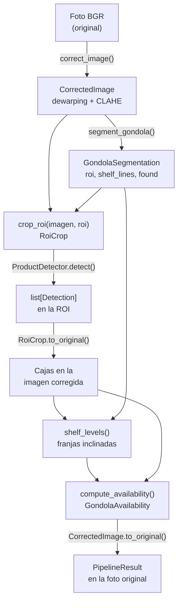

# Especificación técnica

Ítem #9 de `PROGRESS.md`. Describe lo que hace hoy el código (2026-10-22):
qué recibe y qué entrega cada etapa del pipeline, los parámetros con sus
valores, el formato de salida y la app web. El porqué de cada decisión
está en el README ("Decisiones técnicas y su justificación"); cómo
instalar y ejecutar, en "Configuración de un entorno nuevo" y "Ejecución
local".

## 1. Convenciones

- **Coordenadas**: toda caja es `[x_min, y_min, x_max, y_max]` en píxeles
  absolutos (`BBox`, tupla de 4 floats). El origen es la esquina superior
  izquierda.
- **Sistemas de coordenadas**: la corrección de imagen (dewarping)
  cambia la geometría, así que hay tres sistemas: la **foto original**, la
  **imagen corregida** (donde se segmenta y se mide) y la **ROI recortada**
  (donde detecta YOLO26). Cada paso devuelve un objeto que sabe volver al
  sistema anterior (`RoiCrop.to_original()`, `CorrectedImage.to_original()`).
- **Imágenes**: arrays de NumPy en BGR (`uint8`), como los entrega OpenCV.
- **Etapas sin dependencias cruzadas**: `preprocessing`, `models`,
  `postprocessing` y `reporting` no se importan entre sí; se pasan
  tuplas, arrays y *dataclasses*. Solo `src/pipeline.py` las encadena, y
  la app web y el CLI solo llaman a `run_image()`.

## 2. Flujo de datos

## 3. Contratos de cada etapa

### 3.1 Pre-procesamiento (`src/preprocessing/`)

| Función | Entrada | Salida |
| --- | --- | --- |
| `correct_image(image, calibration=None, clip_limit=2.0, tile_grid_size=(8, 8))` | Foto BGR y `LensCalibration` opcional | `CorrectedImage(image, calibration)`. Sin calibración solo aplica CLAHE |
| `segment_gondola(image, params=SegmentationParams())` | Imagen **corregida** | `GondolaSegmentation(roi, shelf_lines, shelves, found)` |
| `crop_roi(image, roi)` | Imagen corregida y la ROI | `RoiCrop(image, roi)`; `to_original(bbox)` vuelve a la imagen corregida |

- **`LensCalibration(camera_matrix, dist_coeffs, fisheye=False)`**: formato de
  OpenCV. `camera_matrix` 3x3; `dist_coeffs` con 4, 5, 8, 12 o 14
  coeficientes (pinhole) o 4 (fisheye). Valida la forma al crearse.
- **`ShelfLine(x_min, x_max, slope, intercept)`**: una repisa como recta
  `y = slope * x + intercept` entre `x_min` y `x_max`.
- **`GondolaSegmentation`**: `roi` es la góndola en píxeles; `shelf_lines`,
  las repisas detectadas (pueden estar inclinadas); `shelves`, rectángulos
  horizontales que solo sirven para recortar; `found` es falso si no se
  encontraron repisas (análisis global).

### 3.2 Detección (`src/models/detector.py`)

| Función | Entrada | Salida |
| --- | --- | --- |
| `ProductDetector(weights, device=None)` | Pesos `.pt` de YOLO26 | Carga el modelo una vez. Rechaza pesos sin la cabeza sin NMS de YOLO26 |
| `detect(image, conf=0.25)` | Imagen BGR (la ROI recortada) | `list[Detection(bbox, score, class_id, class_name)]` en coordenadas de esa imagen |

Una sola clase: `product`. Pesos en uso: `yolo26s-finetune`, el
fine-tuning aceptado el 2026-10-21 (#33 de `PROGRESS.md`); no se
versionan y se comparten dentro del equipo.

### 3.3 Post-procesamiento (`src/postprocessing/`)

| Función | Entrada | Salida |
| --- | --- | --- |
| `shelf_levels(products, segmentation_lines, roi, params=ShelfLevelParams())` | Cajas en la imagen corregida, rectas de la segmentación (`astuple(l)`) y la ROI | Niveles de arriba hacia abajo como cuadriláteros de lados verticales (sup. izq., sup. der., inf. der., inf. izq.). Sin repisas, la ROI es el único nivel |
| `compute_availability(products, levels, params=AvailabilityParams())` | Cajas y niveles | `GondolaAvailability(shelves, free_fraction, critical)` |

- **`ShelfAvailability`** (una por nivel medido): `level_index`, `bbox`,
  `product_count`, `gaps` (tramos libres `(x_inicio, x_fin)`) y `polygon`.
- **Medición**: las cajas de cada nivel se proyectan en X; un tramo sin
  cubrir cuenta como hueco solo si mide al menos `min_gap_products` anchos
  de producto (mediana de la repisa). La góndola se acota del primer al
  último nivel con productos y del producto más a la izquierda al más a la
  derecha. `free_fraction` es el ancho libre sobre el ancho total de todas
  las repisas, y `critical` es `free_fraction >= critical_free_fraction`.
- **Solo se informa la góndola completa**: el % libre y la alerta por
  repisa no son salida (#40).

### 3.4 Pipeline (`src/pipeline.py`)

| Función | Entrada | Salida |
| --- | --- | --- |
| `run_image(image, detector, calibration=None, conf=None, critical_free_fraction=None)` | Foto BGR y un objeto con `detect()` | `PipelineResult` en coordenadas de la foto original |
| `measure_boxes(image, boxes)` | Foto y cajas dadas (por ejemplo, una anotación hecha a mano) | `PipelineResult` medido con esas cajas, sin detector (referencia de CU07) |

### 3.5 Reportes (`src/reporting/`)

| Función | Entrada | Salida |
| --- | --- | --- |
| `draw_availability(image, result, banner=True)` | Foto original y `PipelineResult` | Copia de la foto con los huecos en rojo, el contorno de las repisas y, con `banner`, un cartel con la alerta y el % libre |
| `export(rows, fmt, title)` | Filas (`fecha`, `pasillo`, `gondola`, `free_fraction`, `critical`, `estado`, `usuario`) y `"xlsx"`, `"csv"` o `"pdf"` | Bytes del archivo. El texto que empieza como fórmula (`=`, `+`, `-`, `@`) se guarda como texto |

### 3.6 Evaluación (`src/evaluation/`, fuera del pipeline)

`match_detections(predicted, truth, iou_threshold=0.5)` empareja cajas
1 a 1 por IoU y devuelve `DetectionMetrics` (verdaderos y falsos
positivos, falsos negativos, precisión, recall, F1 e IoU medio).
`shelf_evaluation` mide las repisas contra SHARD (#15).

## 4. Parámetros y constantes

| Parámetro | Valor | Dónde | Qué controla |
| --- | --- | --- | --- |
| Umbral de quiebre | 30% del frente (1-100%, configurable en CU05) | `CRITICAL_FREE_FRACTION`, `Config.umbral` | Espacio libre desde el que se alerta |
| Hueco mínimo | 1 ancho de producto | `AvailabilityParams.min_gap_products` | Separación normal entre productos que no cuenta como hueco |
| Solape mínimo con el nivel | 30% del alto | `AvailabilityParams.min_level_overlap` | Cuándo una caja cubre un nivel |
| Profundidad de góndola | 25 cm (constante global) | `GONDOLA_DEPTH_CM` | Única profundidad del análisis 2D; no se estima |
| Tamaño de inferencia | 1280 px | `detector.IMGSZ` | Resolución con que YOLO26 ve la ROI |
| Detecciones máximas | 1000 | `detector.MAX_DET` | Evita truncar góndolas llenas (el valor de Ultralytics es 300) |
| Confianza mínima | 0,25 | `detector.DEFAULT_CONF` | Detecciones descartadas |
| NMS | Desactivado (`nms=False`) | `ProductDetector.detect()` | Cabeza sin NMS de YOLO26, para productos apilados |
| CLAHE | `clip_limit=2.0`, cuadrícula 8x8 | `correct_image()` | Ecualización local del contraste |
| Inclinación máxima de una repisa | 8° (segmentación) y 35° (niveles híbridos) | `SegmentationParams.max_tilt_deg`, `ShelfLevelParams.max_tilt_deg` | Repisas en ángulo que se aceptan |
| Emparejamiento por IoU | 0,5 | `evaluation.IOU_THRESHOLD` | Acierto de detección en CU07 |

Los demás parámetros de `SegmentationParams` y `ShelfLevelParams` están
documentados campo por campo en su código.

## 5. Formato de salida (JSON)

`PipelineResult.to_dict()`, que escribe `run_pipeline.py` por foto
(`<nombre>.json`) y guarda la app web en `Analysis.result`:

| Campo | Tipo | Contenido |
| --- | --- | --- |
| `image_size` | `[ancho, alto]` | Tamaño de la foto original |
| `roi` | `BBox` | Góndola segmentada, en la foto original |
| `products` | `BBox[]` | Productos detectados, en la foto original |
| `shelves` | objeto[] | Geometría de cada nivel medido: `level_index`, `polygon` (contorno, 9 puntos por borde para seguir la curva del lente), `gaps` (un polígono por hueco) y `product_count`. Sin % ni alerta por repisa |
| `free_fraction` | float, 0 a 1 | Espacio libre de la góndola completa |
| `critical` | bool | Alerta de quiebre de la góndola completa |
| `segmentation_found` | bool | Falso si no se encontraron repisas (análisis global) |
| `times` | objeto | Segundos por etapa: `correction`, `segmentation`, `detection`, `availability` y `total` |

Ejemplo (foto 026 de Kaggle, CPU): 94 productos, 6 repisas,
`free_fraction` 0,022, `critical` falso y `total` 1,0 s.

## 6. App web (`web/`)

### 6.1 Rutas y permisos

| Ruta | Vista | Administrador | Jefe de Salón | Reponedor | Caso de uso |
| --- | --- | --- | --- | --- | --- |
| `/` | Inicio según el perfil | → Usuarios | → Góndolas | → Alertas | CU00 |
| `/login/`, `/logout/`, `/clave/<uid>/<token>/` | Entrar, salir y definir la contraseña | Sí | Sí | Sí | CU00, CU06 |
| `/usuarios/`, `/usuarios/nuevo/`, `/usuarios/<pk>/` | Lista, crear y editar usuarios | Sí | No | No | CU06 |
| `/usuarios/<pk>/enlace/` (POST) | Reenviar el enlace de la contraseña | Sí | No | No | CU06 |
| `/gondolas/`, `/gondolas/<pasillo>/<góndola>/` | Dashboard e historial de una góndola | Sí | Sí | Sí | CU03 |
| `/analisis/` | Subir una foto y ver los últimos análisis | Sí | Sí | No | CU01 |
| `/analisis/<pk>/`, `/analisis/<pk>/imagen.jpg` | Detalle y foto anotada (solo con sesión) | Sí | Sí | Sí | CU01 |
| `/alertas/`, `/alertas/<pk>/<acción>/` (POST) | Alertas abiertas; tomar o completar | Sí | Sí | Sí | CU02 |
| `/reportes/` | Exportar Excel, CSV o PDF | Sí | Sí | No | CU04 |
| `/configuracion/`, `/configuracion/camaras/...` | Umbral y cámaras | Sí | No | No | CU05 |

Un perfil sin permiso recibe 403. CU07 (evaluación por lotes) va por
`scripts/run_pipeline.py --annotations`, no por la app.

### 6.2 Modelo de datos

| Tabla | Campos principales | Notas |
| --- | --- | --- |
| `User` | `username` (RUT normalizado, `12345678-5`), `email` (único), `is_active`, `failed_logins` | El perfil es su grupo de Django (Administrador, Jefe de Salón o Reponedor); un superusuario es Administrador. Las cuentas no se borran, se desactivan |
| `Analysis` | `created_at`, `created_by`, `pasillo`, `gondola`, `photo_name`, `free_fraction`, `critical`, `result` (JSON de la sección 5), `annotated` (foto anotada), `estado`, `taken_by`, `estado_at` | Un análisis por foto y, si hay quiebre, su alerta. `estado`: activa, en_proceso, completada o reemplazada |
| `Config` | `umbral` (1-100, 30 por defecto) | Una sola fila (`Config.get()`) |
| `Camera` | `nombre` (único), `pasillo`, `gondola`, `calibracion` (JSON de OpenCV) | Una cámara por góndola |

El modelo lógico y relacional de la base está en `Anexos/Diseño/Base de datos/`;
cubre `User`, los perfiles y `Analysis`. `Config` y `Camera` (#44) son posteriores.

### 6.3 Reglas de negocio

- **Login (CU00)**: con RUT (con o sin puntos) o correo. Tras 5 intentos
  fallidos seguidos la cuenta queda inactiva; solo el Administrador la
  reactiva. La sesión expira tras 2 h sin uso. Contraseñas con bcrypt
  (`BCryptSHA256PasswordHasher`).
- **Análisis (CU01)**: foto JPG o PNG de hasta 20 MB, con pasillo y
  góndola. Se usan el umbral configurado y la calibración de la cámara de
  esa góndola, si existe. Una foto sin productos detectados se rechaza.
  El pasillo y la góndola se guardan sin espacios y en mayúsculas.
- **Alertas (CU02)**: una góndola tiene a lo más una alerta abierta. Una
  foto nueva con quiebre reemplaza a la anterior y conserva su estado; una
  sin quiebre la cierra. Cerrar la alerta anterior y crear el análisis van en
  una transacción (todo o nada), y SQLite en modo `IMMEDIATE` procesa una
  tras otra dos fotos de la misma góndola. Tomar o completar una alerta
  solo cambia su estado si sigue en el estado de origen.
- **Dashboard (CU03)**: estado por la última foto. Quiebre si tiene
  alerta; en riesgo desde la mitad del umbral; disponible bajo la mitad;
  sin datos si no hay foto en 24 h.
- **Privacidad (RNF05)**: `python manage.py borrar_fotos --dias 30` borra
  las fotos con más de 30 días y conserva su resultado.

## 7. Línea de comandos

| Comando | Para qué |
| --- | --- |
| `scripts/run_pipeline.py FOTOS... [--annotations CSV]` | Pipeline sobre fotos o carpetas: vista anotada y JSON por foto; con anotaciones, métricas de CU07 |
| `scripts/download_datasets.py` y `scripts/prepare_datasets.py` | Descargar los datasets y convertir sus anotaciones al formato estándar |
| `scripts/prepare_yolo_dataset.py`, `scripts/prepare_finetune_dataset.py` y `scripts/train_detector.py` | Armar los datasets de entrenamiento y entrenar o afinar YOLO26 (`docs/training.md`) |
| `scripts/evaluate_shard.py` | Medir la segmentación de repisas contra SHARD |
| `scripts/evaluate_availability.py` | Medir el criterio de quiebre |
| `scripts/visualize_segmentation.py` | Revisar la segmentación a ojo |
| `manage.py migrate`, `createsuperuser`, `runserver` | Crear la base, el primer Administrador y levantar la app |
| `manage.py borrar_fotos --dias N` | Borrar fotos antiguas (RNF05) |

## 8. Requisitos de ejecución

- Python 3.12 o superior (Django 6.1); la CI y la imagen Docker usan 3.13.
- Dependencias en `requirements.txt`; YOLO26 con `ultralytics>=8.4.0`.
- CPU basta: el pipeline tarda cerca de 1 s por foto (mediana de 0,5 s en
  lote, README). La GPU solo se usa para entrenar.
- Variables de entorno de la app: ver README, "Aplicación web".
